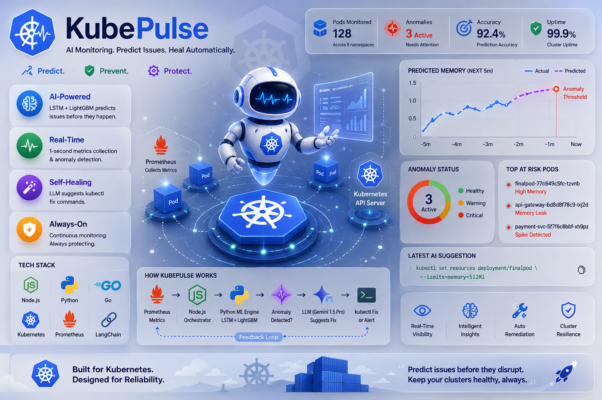

# 🛡️ KubePulse — Predictive Kubernetes AIOps Agent



> **Real-time pod memory forecasting, anomaly detection, and predictive autoscaling for Kubernetes workloads.**

[](https://github.com/Mounusha25/Kube_Pulse/actions/workflows/ci.yml)
[](https://nodejs.org/)
[](https://python.org/)
[](https://golang.org/)
[](https://kubernetes.io/)
[](https://prometheus.io/)
[](https://tensorflow.org/)
[](https://ai.google.dev/)

---

## Overview

**KubePulse** is an AIOps agent that dynamically discovers Kubernetes pods by label, maintains independent forecasting state for each pod, predicts memory anomalies, exports per-pod forecasts to Prometheus, and makes those forecasts available to Kubernetes HPA through Prometheus Adapter. It can optionally ask a Large Language Model for a remediation suggestion; commands are logged for review and are never executed automatically.

Traditional Kubernetes monitoring tools alert you *after* a problem occurs. KubePulse is **predictive**: it uses a hybrid LSTM + LightGBM ML pipeline to forecast memory behavior and detect anomalies before they escalate into `CrashLoopBackOff` or OOMKilled events.

---

## Architecture

```
┌─────────────────────────────────────────────────────────────────┐
│                        KubePulse Agent                          │
│                                                                 │
│  ┌──────────────┐    ┌──────────────┐    ┌───────────────────┐  │
│  │  Prometheus  │───▶│  Node.js     │───▶│  Python ML Engine │  │
│  │  (Metrics)   │    │  Orchestrator│    │  (LSTM + LightGBM)│  │
│  └──────────────┘    └──────┬───────┘    └────────┬──────────┘  │
│           ▲                 │                     │             │
│           │        POST     │            Anomaly? │             │
│  ┌────────┴───────┐         │                     ▼             │
│  │  Go Prometheus │◀────────┘         ┌───────────────────────┐ │
│  │  Exporter      │  /report          │  Gemini API (optional)│ │
│  │  /metrics      │                   │  kubectl fix command  │ │
│  └────────────────┘                   └───────────────────────┘ │
│  ┌──────────────┐                                               │
│  │  Kubernetes  │◀── HPA can scale based on custom metrics      │
│  │  API Server  │                                               │
│  └──────────────┘                                               │
└─────────────────────────────────────────────────────────────────┘
```

### Data Flow

1. **Dynamic Discovery** — Lists active pods matching a Kubernetes label selector and removes state for terminated pods
2. **Metrics Collection** — Queries Prometheus every second for each discovered pod's `container_memory_usage_bytes`
3. **Normalization** — Values are normalized against each pod's own configured memory limit fetched from the Kubernetes API
4. **Per-pod Windows** — Maintains an independent rolling window of 10 data points for every active pod
5. **ML Prediction** — The Node.js process streams each window to a persistent Python subprocess; the LSTM forecasts the next memory value
6. **Anomaly Classification** — LightGBM classifies each forecast as healthy or anomalous
7. **Metrics Export** — Every prediction is exported with `namespace` and `pod` labels
8. **Per-pod Autoscaling Metric** — Prometheus Adapter maps the forecast to the Kubernetes custom metrics API; HPA uses a Pods `AverageValue` target
9. **Optional LLM Suggestion** — When explicitly enabled, an anomaly can be sent to the **Gemini API** for a proposed `kubectl` command; suggestions are never executed
10. **Critical Triage** — A pod already in `CrashLoopBackOff` is escalated instead of auto-remediated

---

## ML Pipeline

### Hybrid LSTM + LightGBM Model

| Component | Role | Details |
|-----------|------|---------|
| **LSTM** | Time-series forecasting | Trained reproducibly on versioned workload traces (10-step input → next value) |
| **LightGBM** | Anomaly classification | Binary classifier on LSTM-predicted output: `0` = healthy, `1` = anomaly |

The **hybrid approach** separates concerns: LSTM captures temporal patterns in memory usage while LightGBM provides fast, interpretable anomaly classification on top of the forecast — a design that reduces false positives compared to threshold-based alerting.

### Reproducible benchmark

The v2 model is trained and evaluated with one command on deterministic normal,
burst, gradual-leak, and oscillating workload traces:

```bash
python3.12 -m venv .venv
source .venv/bin/activate
pip install -r requirements.lock
python -m ml.run_benchmark
python -m ml.validate_results
```

The benchmark uses chronological 60/20/20 splits with no shuffled future
samples. A positive label means memory reaches its configured limit within the
next 10 seconds. On the fixed 14,400-row benchmark (24 traces, 2,640 held-out
examples), the current results are:

| Method | F1 | PR-AUC | False-alert rate | Breach-event recall | Mean warning |
|---|---:|---:|---:|---:|---:|
| Static threshold (0.85) | 0.757 | 0.849 | 6.39% | 100% | 6.11s |
| Prometheus-style 0.90 for 3 samples | 0.753 | 0.808 | 3.86% | 68.4% | 6.46s |
| Linear trend (5 samples) | 0.802 | 0.874 | 4.44% | 100% | 6.26s |
| **LSTM + LightGBM v2** | **0.839** | **0.881** | **2.13%** | **100%** | **5.84s** |

The LSTM forecast reaches `0.0201` MAE and `0.0397` RMSE, versus `0.0215`
and `0.0424` for persistence. Full machine-readable and Markdown reports are
stored under `benchmarks/results/`.

These are controlled synthetic workload results for regression and architecture
validation—not measurements from a production Kubernetes cluster. The next
section reports the separate real-cluster HPA experiment.

### Real Minikube HPA comparison

The repository also contains an end-to-end Minikube experiment with a real
Deployment, distributed ramp load, Metrics Server, Prometheus Operator,
Prometheus Adapter, the containerized KubePulse agent, and its Go exporter.

| Policy | First scale | Peak replicas | Replica-seconds | Failed requests | Restarts/OOMs |
|---|---:|---:|---:|---:|---:|
| Standard memory HPA | 75.14s | 4 | 255 | 0 | 0 / 0 |
| KubePulse predictive HPA | **15.02s** | 4 | 405 | 0 | 0 / 0 |

KubePulse scaled **60.12 seconds earlier** in this run. Unlike the earlier
single-external-metric policy, both policies peaked at four replicas after the
predictive HPA was changed to a per-pod `AverageValue` target. Predictive scaling
still consumed 150 additional replica-seconds, so the latency/capacity tradeoff
is reported rather than hidden. This experiment establishes that dynamic pod
discovery and forecasts close the Prometheus-to-HPA loop; repeated trials and
workload-specific threshold calibration remain necessary. Raw samples and the
machine-readable summary live in `experiments/results/cluster/`; see
[`experiments/README.md`](experiments/README.md) for reproduction steps.

### Model drift monitoring

KubePulse versions its drift baseline with the deployed model in
`models/v2/drift_reference.json`. The artifact records the source dataset
SHA-256, histogram bins, training proportions, and separate PSI thresholds for
normalized memory inputs and LSTM forecasts. Thresholds are calibrated at the
95th percentile across the untouched chronological validation traces instead
of assuming that a generic PSI cutoff fits this workload.

At runtime, each discovered pod keeps bounded input and forecast buffers. After
60 paired samples, KubePulse evaluates both distributions and requires three
consecutive shifted windows before declaring drift. The Go exporter exposes:

- `kubeguard_input_drift_psi` and `kubeguard_prediction_drift_psi`
- `kubeguard_drift_ready` and `kubeguard_drift_window_samples`
- `kubeguard_drift_detected` and `kubeguard_retraining_recommended`

The included `PrometheusRule` alerts only on sustained, ready drift state. A
drift alert recommends investigation; it never changes the deployed model.
Exporter series for terminated pods expire automatically (five minutes by
default, configurable with `KUBEGUARD_STALE_AFTER`) so stale labels cannot keep
old drift alerts alive indefinitely.
Candidate training is available through the manually dispatched
`Build retraining candidate` GitHub Actions workflow. Configure a required
reviewer on the `model-retraining-approval` GitHub environment to enforce the
approval gate. The workflow trains, runs the quality gate, and uploads a
14-day candidate artifact—it does not commit or deploy it.

The checked-in Minikube smoke test reached ready state after 94 paired samples
and correctly flagged the idle workload as outside the synthetic training
distribution (input PSI `21.2921`, forecast PSI `21.2815`). That finding is
recorded as a training-coverage gap, not a resolved accuracy claim; see
[`monitoring/results/`](monitoring/results/). The retraining workflow requires a
reviewed, versioned CSV under `data/`, so it cannot silently train on unlabeled
live traffic.

For an offline comparison, provide live values in a CSV with `memory_ratio` and
`predicted_memory_ratio` columns:

```bash
python -m ml.drift_report --live live-memory.csv --output drift-report.json
```

This writes machine-readable JSON and a Markdown comparison using the same
calibrated reference as the online monitor.

---

## Tech Stack

| Layer | Technology |
|-------|-----------|
| **Orchestration** | Node.js (ESM) |
| **Kubernetes Integration** | Kubernetes REST API (in-cluster service account or local proxy) |
| **Metrics** | Prometheus + PromQL |
| **Custom Metrics Exporter** | Go 1.22, Prometheus `client_golang` SDK |
| **ML Inference** | TensorFlow/Keras (LSTM), LightGBM, NumPy |
| **LLM Integration** | Optional Google Gemini HTTPS API |
| **IPC** | Node.js `child_process` → Python subprocess via `stdin/stdout` |
| **Containerization** | Docker (multi-stage build) |
| **Deployment** | Docker, Kubernetes, Helm, Prometheus Operator/Adapter |

---

## Project Structure

```
KubePulse/
├── index.js                        # Main agent: metrics collection, orchestration, LLM integration
├── src/monitor.js                  # Dynamic discovery and independent per-pod windows
├── hybrid_predict.py               # ML inference engine: LSTM + LightGBM anomaly detection
├── ml/                              # Deterministic data, training, evaluation, quality gate
├── data/kubepulse_benchmark.csv     # Versioned 14,400-row benchmark dataset
├── models/v2/                       # Reproducible LSTM, LightGBM, and metadata
│   └── drift_reference.json         # Versioned PSI baseline and calibrated thresholds
├── benchmarks/results/              # JSON and Markdown benchmark reports
├── experiments/                     # Minikube workloads, HPAs, raw samples, report
├── monitoring/results/              # Live drift smoke-test evidence
├── docker/Dockerfile.agent          # Node 20 + Python 3.12 inference image
├── scripts/setup_minikube_experiment.sh
├── .github/workflows/retrain-candidate.yml
├── tests_py/                        # Dataset and feature-pipeline tests
├── package.json                    # Node.js dependencies
└── kubeguard-exporter/              # Go Prometheus custom metrics exporter
    ├── main.go                     # HTTP server exposing /report and /metrics
    ├── go.mod                      # Go module definition
    ├── Dockerfile                  # Multi-stage Docker build
    └── k8s/
        └── exporter-deployment.yaml  # Kubernetes Deployment + Service
```

---

## Go Prometheus Exporter (`kubeguard-exporter`)

A purpose-built Go microservice that acts as the **metrics bridge** between the KubePulse agent and Prometheus.

### Exposed Endpoints

| Endpoint | Method | Description |
|----------|--------|-------------|
| `POST /report` | POST | Receives JSON predictions from the Node.js agent |
| `GET /metrics` | GET | Prometheus scrape endpoint with custom metrics |
| `GET /healthz` | GET | Liveness/readiness health check |

### Custom Prometheus Metrics

| Metric | Type | Description |
|--------|------|-------------|
| `kubeguard_predicted_memory_ratio` | Gauge | LSTM-forecasted memory ratio, labeled by namespace and pod |
| `kubeguard_anomaly_detected` | Gauge | 1 = anomaly active, 0 = healthy |
| `kubeguard_anomalies_total` | Counter | Cumulative anomaly detections since exporter start |
| `kubeguard_input_drift_psi` | Gauge | PSI for the live normalized-memory distribution |
| `kubeguard_prediction_drift_psi` | Gauge | PSI for the live forecast distribution |
| `kubeguard_drift_detected` | Gauge | 1 after the configured consecutive drift windows |
| `kubeguard_retraining_recommended` | Gauge | Human-review signal; never an automatic deployment trigger |

### Deploy the Exporter

```bash
# Build the Docker image
cd kubeguard-exporter
docker build -t kubeguard-exporter:latest .

# Deploy to Kubernetes
kubectl apply -f k8s/exporter-deployment.yaml

# Verify it's running
kubectl get pods -l app=kubeguard-exporter
```

### HPA Integration (Horizontal Pod Autoscaler)

KubePulse exposes `kubeguard_predicted_memory_ratio` as a Prometheus metric. The included Prometheus Adapter rule and predictive HPA consume it to scale the experiment workload, closing the full metrics-to-scaling loop.

---

## Getting Started

### Prerequisites

- Kubernetes cluster running locally (e.g., [minikube](https://minikube.sigs.k8s.io/) or [kind](https://kind.sigs.k8s.io/))
- Prometheus deployed in the cluster with `container_memory_usage_bytes` metrics available
- Python 3.12+ with pip
- Node.js 20+
- `kubectl proxy` running on `localhost:8001` for local execution (not needed in-cluster)

### 1. Clone the Repository

```bash
git clone https://github.com/Mounusha25/Kube_Pulse.git
cd Kube_Pulse
```

### 2. Install Node.js Dependencies

```bash
npm install
```

### 3. Install Python Dependencies

```bash
pip install tensorflow keras lightgbm numpy joblib
```

### 4. Start the Kubernetes API Proxy

```bash
kubectl proxy --port=8001
```

### 5. Configure the Target Pods

Configuration is supplied through environment variables; no source edit is
required:

```bash
export KUBEPULSE_POD_SELECTOR='app=your-service'
export KUBEPULSE_NAMESPACE=default
# Optional when a pod has multiple containers:
export KUBEPULSE_CONTAINER_NAME=app
```

For a single fixed pod, set `KUBEPULSE_POD_NAME` instead. Set exactly one of
`KUBEPULSE_POD_SELECTOR` and `KUBEPULSE_POD_NAME`.

The runtime accepts Kubernetes memory quantities such as `512Mi`, `1Gi`, and
`500M`. Prometheus, Kubernetes proxy, exporter, polling, and timeout settings
can also be overridden with `KUBEPULSE_PROMETHEUS_URL`,
`KUBEPULSE_KUBE_API_URL`, `KUBEPULSE_EXPORTER_URL`,
`KUBEPULSE_POLL_INTERVAL_MS`, `KUBEPULSE_REQUEST_TIMEOUT_MS`, and
`KUBEPULSE_PREDICTION_TIMEOUT_MS`.

Drift monitoring is enabled by default. Its bounded-window settings can be
changed with `KUBEPULSE_DRIFT_WINDOW_SIZE`, `KUBEPULSE_DRIFT_MIN_SAMPLES`, and
`KUBEPULSE_DRIFT_CONSECUTIVE_WINDOWS`. The versioned reference supplies the
calibrated thresholds; `KUBEPULSE_DRIFT_THRESHOLD` intentionally overrides both
only when explicitly set. Use `KUBEPULSE_DRIFT_ENABLED=false` to disable it.

LLM remediation suggestions are disabled by default. Set
`KUBEPULSE_REMEDIATION_ENABLED=true`, `GOOGLE_API_KEY`, and
`KUBEPULSE_GEMINI_MODEL` only if you want suggestions; KubePulse still never
executes the returned command.

### 6. Run KubePulse

```bash
npm run dev
```

KubePulse will begin collecting metrics. After 10 seconds of warm-up, ML predictions start streaming and anomaly detection goes live.

### 7. Run the reliability tests

```bash
npm test
```

The 30 Node tests cover dynamic discovery, per-pod state lifecycle, PSI drift
detection, consecutive-window gating, failure
isolation, Kubernetes quantity parsing and container selection, Prometheus
response validation, structured ML output, remediation routing, and Gemini
request safety. Nine Python tests cover deterministic data, chronological
splits, the model feature contract, drift-reference integrity, and PSI shift
detection. The exporter also has Go handler tests. Suggested commands are
logged but never executed.

### Run the real-cluster experiment

With Docker Desktop running:

```bash
./scripts/setup_minikube_experiment.sh
python3 experiments/run_cluster_comparison.py --duration 150 --interval 5
```

---

## Sample Output

```
[KubePulse] Collecting memory metrics...
[0.42, 0.45, 0.48, 0.51, 0.53, 0.58, 0.63, 0.71, 0.79, 0.88]

✅ Healthy. Predicted Memory: 0.91

⚠️  Anomaly Detected! Predicted Memory: 1.24 (exceeds limit)
🧠 LLM suggests: kubectl set resources deployment/finalpod --limits=memory=512Mi

⚠️  CRITICAL: Pod finalpod-77c649c5fc-tzvnb is leaking memory. Notify cluster administrator.
```

---

## How It Compares to Traditional Approaches

| Approach | Detection Timing | False Positives | Auto-Remediation |
|----------|-----------------|-----------------|-----------------|
| Threshold alerts | After breach | High | ❌ |
| Prometheus alerting rules | After breach | Medium | ❌ |
| **KubePulse (LSTM + LightGBM)** | **Forecast-driven** | **Measured by benchmark** | **Human-reviewed suggestion** |

---

## Key Engineering Decisions

- **Subprocess IPC over REST** — The Python ML engine runs as a persistent subprocess rather than a separate microservice, eliminating HTTP overhead for high-frequency (1 Hz) inference
- **Go for the metrics layer** — The exporter is written in Go using the official `prometheus/client_golang` SDK — the same stack used by production K8s operators — keeping the scrape path lightweight and idiomatic
- **Normalized memory inputs** — Memory is normalized against each pod's individual limit, making the model portable across pods with different memory configurations
- **LLM opt-in** — LLM suggestions are disabled by default, invoked only on confirmed anomalies when enabled, and never executed by the agent
- **CrashLoopBackOff triage** — Distinguishes between recoverable anomalies (auto-fix) and critical failures (human escalation), avoiding dangerous automated actions on already-failing pods

---

## Future Improvements

- [x] Multi-pod monitoring with dynamic pod discovery and independent windows
- [x] Versioned input/prediction drift monitoring with approval-gated retraining
- [ ] CPU usage anomaly detection alongside memory
- [ ] Slack/PagerDuty integration for critical alerts
- [ ] Automatic execution of LLM-suggested commands (with approval workflow)
- [ ] Tune the predictive HPA threshold across repeated real-cluster trials
- [ ] Grafana dashboard for real-time anomaly visualization
- [ ] Model retraining pipeline on new cluster data

---

## Author

**Mounusha** — [GitHub](https://github.com/Mounusha25)

---

*Built with a focus on proactive reliability engineering for production Kubernetes environments.*
